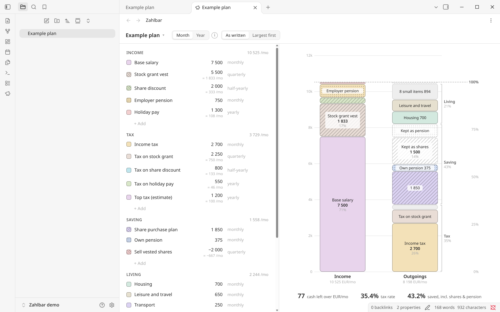

# Zahlbar

Plan your money in a Markdown note and see it in Obsidian as two bars: what comes in, and where it goes.

I made it for my own plan. Part of my pay arrives as shares and pension, some of the tax is paid by selling shares, and I wanted to see what is actually left in cash. If your income is only a salary, a spreadsheet may be enough.

The name is German for payable, and also reads as *Zahl* (number) plus bar.

<picture>
  <source media="(prefers-color-scheme: dark)" srcset="docs/screenshot-dark.png">
  
</picture>

## Install

Zahlbar isn't in the community plugin list yet. Download `main.js`, `manifest.json` and `styles.css` from the latest release into `<vault>/.obsidian/plugins/zahlbar/` and enable it under Community plugins. Or build it from source, see below.

## Try it

Copy [examples/Example plan.md](examples/Example%20plan.md) into your vault and run **Zahlbar: Open plan**. Edits in the pane go straight into the note, and edits in the note show up in the pane. Double-click a swatch to hide a line, drag a row to reorder it, and hover the chart to see where a number comes from.

## Writing a plan

A plan is a note with `zahlbar: 1` in its frontmatter and four headings: Income, Tax, Saving and Living. Each bullet is one entry.

```markdown
---
zahlbar: 1
currency: EUR
---
## Income
- Salary: 6 000
- Stock vest: 4 000 quarterly {shares}
- Employer pension: 500 {pension}

## Tax
- Income tax: 2 200
- Tax on vest: 1 600 quarterly {shares}

## Saving
- Sell shares: -1 000 quarterly {shares}

## Living
- Rent: 1 300
- ~~Car: 400~~
```

Amounts are per occurrence and monthly unless you say otherwise. `{shares}` and `{pension}` mark money you can't spend, and on a tax line `{shares}` means it's paid by selling shares. A negative Saving line takes money out. Strike a line through to leave it out of the totals. [FORMAT.md](FORMAT.md) has the full syntax and how the totals are calculated.

## What it doesn't do

It's a plan, not a ledger. There are no transactions, no bank import and no network calls. Everything is an average per month or per year, with no timing within the year and no growth over time. One currency per plan.

## Development

```bash
npm install
npm run build
npm test
npm run harness
npm run install:vault -- "/path/to/vault"
```

`src/core` parses, writes and computes plans without touching Obsidian. The harness runs the real pane in headless Chromium against a stubbed Obsidian.

## Licence

MIT
